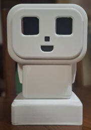
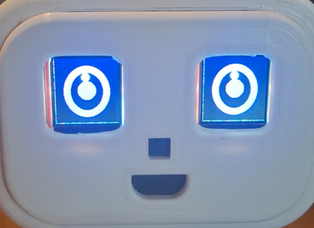
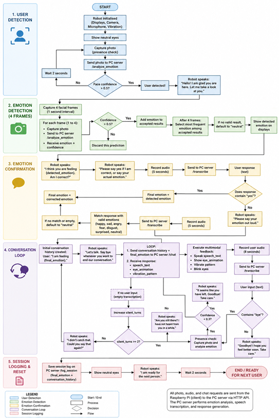
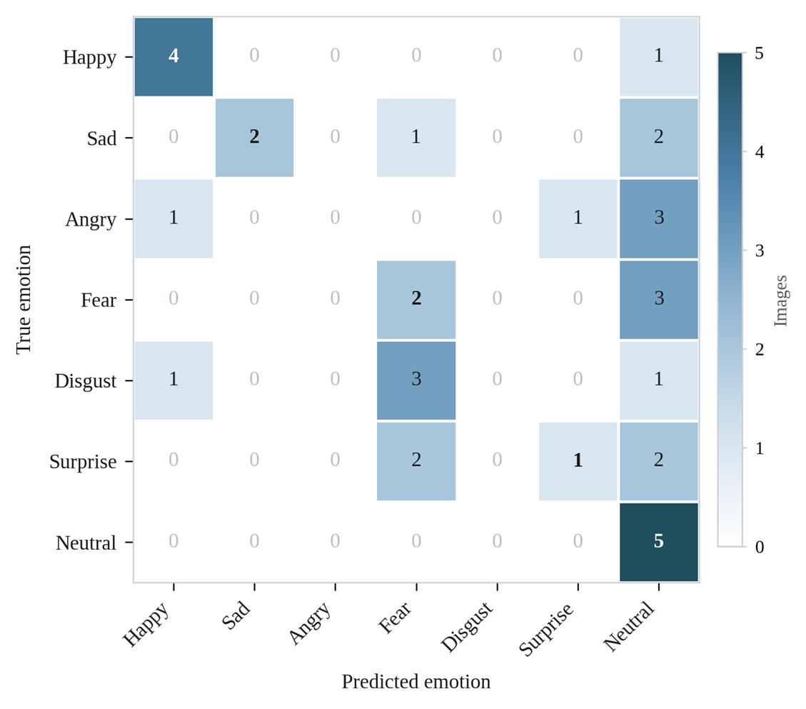

# Emotion-Aware Companion Robot with Human-in-the-Loop FER & Multimodal LLM Dialogue

A stationary, low-cost companion robot designed to mitigate academic stress through real-time facial expression recognition, speech-driven emotion verification, and context-aware conversational feedback[cite: 32, 38, 48]. 

Built on a **distributed Raspberry Pi 4 + PC server architecture**, the system decouples real-world sensor/actuator I/O from heavy neural inference pipelines (DeepFace, Faster-Whisper, and GPT-4o-mini)[cite: 32, 51, 52, 63, 64].



---

## 💡 Key Architectural Insights

1. **Human-in-the-Loop Emotion Confirmation:** Standard FER models underperform under unconstrained lighting and variable poses[cite: 39, 44]. Instead of responding directly to raw vision classifications, the robot asks for verbal confirmation (e.g., *"I think you are feeling sad. Am I correct?"*), enabling the user to confirm or correct their emotional state before shaping the conversation[cite: 32, 49, 54].
2. **Distributed Pi/PC Split Architecture:** Heavy AI inference is offloaded over local HTTP APIs to a host PC, allowing responsive performance without requiring dedicated hardware accelerators on the robot[cite: 32, 51, 52].
3. **Trimodal Affective Output:** Combines synthetic voice, dynamic animated LCD eyes across two SPI displays, and haptic vibration feedback in real time[cite: 32, 48, 55].

---

## 🛠 System Hardware & Pinout



### Hardware Components
* **Embedded Controller:** Raspberry Pi 4 Model B (4GB / 8GB)[cite: 55, 56]
* **Camera Module:** Raspberry Pi Camera Module v1.3 (Sony OV5647, CSI ribbon)[cite: 55, 56]
* **Microphone:** INMP441 MEMS Digital Microphone (I2S interface)[cite: 55, 57]
* **Eye Displays:** 2× ST7735 1.44" $128 \times 128$ SPI TFT LCDs[cite: 55, 57]
* **Haptic Actuator:** Eccentric Rotating Mass (ERM) Vibration Motor Module[cite: 55, 58]
* **Audio Playback:** PAM8403 3W Stereo Amplifier + Miniature Speaker via 3.5mm TRRS jack[cite: 55, 59]
* **Chassis:** Custom 3D-printed enclosure with dedicated mounting and ventilation slots[cite: 51, 55, 59]

### Raspberry Pi 4 Hardware Pinout

| Peripheral | Signal | BCM / GPIO | Physical Pin | Notes / Workarounds |
| :--- | :--- | :--- | :--- | :--- |
| **LCD 1 (Left Eye)** | MOSI / SCLK | GPIO 10 / 11 | Pins 19 / 23 | Shared SPI data & clock bus[cite: 94] |
| | CS / DC / RST | GPIO 8 / 24 / 25 | Pins 24 / 18 / 22 | Dedicated chip select & reset lines[cite: 94] |
| **LCD 2 (Right Eye)** | MOSI / SCLK | GPIO 10 / 11 | Pins 19 / 23 | Shared SPI data & clock bus[cite: 94] |
| | CS / DC / RST | GPIO 7 / 23 / 27 | Pins 26 / 16 / 13 | Dedicated chip select & reset lines[cite: 94] |
| **INMP441 Mic** | BCLK / WS / SD | GPIO 18 / 19 / 20 | Pins 12 / 35 / 38 | I2S mono mode (L/R tied to GND)[cite: 94] |
| **ERM Vibration** | PWM / Digital IN | GPIO 26 | Pin 37 | Driven via daemon thread[cite: 58, 94, 127] |
| **PAM8403 Amp** | Audio Output | Analog Audio | 3.5mm TRRS | Requires 4-pole TRRS adapter[cite: 59, 95] |

> **Critical Hardware Fixes Implemented:**
> * **Audio Output Grounding:** Standard 3-pole TRS audio cables short ground to composite video on the Pi 4[cite: 59, 95]. A 4-pole TRRS-to-TRS adapter resolves ground looping[cite: 59, 95].
> * **I2S Overlay Conflict:** Standard `i2s-mmap` can lead to kernel panic on boot; replaced with `dtoverlay=googlevoicehat-soundcard` in `/boot/firmware/config.txt`[cite: 73].
> * **Display SPI Driver:** Built a custom `spidev` + `RPi.GPIO` frame-streamer to manage independent Chip Select lines without library locking conflicts[cite: 57, 73, 95].
> * **Mic Pre-amplification:** Raw INMP441 I2S samples record at ~4% full scale; handled via software gain staging (`sox gain 20`)[cite: 57, 112].

---

## 🧠 Software Architecture & Workflow



## Code Snippet

### 1. Presence & Emotion Recognition Pipeline
* **Presence Polling:** Evaluates camera frames at 2-second intervals using DeepFace face-confidence scoring ($>0.5$ threshold triggers the session)[cite: 53, 61, 100].
* **Multi-Frame Majority Voting:** Once a user is detected, captures 4 consecutive frames at 1-second intervals, discarding frames $<0.5$ confidence, and determines the dominant emotion class[cite: 53, 61, 100].
* **Voice-Driven Confirmation Loop:** Speaks the predicted emotion via `eSpeak`, records user speech for 5 seconds, and retains or updates the emotional state via keyword parsing before querying the LLM[cite: 54, 61, 65, 100, 116].

### 2. Conversational Generation (JSON Schema)
The PC Flask server constraints `GPT-4o-mini` to enforce coordinated multimodal feedback[cite: 60, 64, 109]:
```json
{
  "speech_text": "I hear how demanding the workload is. Remember to take small breaks.",
  "eye_animation": "sad_soft",
  "vibration_pattern": "slow_pulse"
}
```[cite: 64, 109]

* **Supported Expressions:** `neutral`, `happy`, `sad`, `sad_soft`, `angry`, `fear`, `surprised`, `disgust`, `calm`, `focused`, `blink`[cite: 101, 102, 123, 124, 125].
* **Supported Haptics:** `none`, `short_pulse` (3 rapid pulses), `slow_pulse` (rhythmic cat-purr bursts), `steady_light` (continuous micro-vibrations)[cite: 58, 109, 126, 127].

---

## 📊 Measured Performance & Benchmarks

The system was evaluated through functional integration tests and instrumented runtime benchmarks under real operating conditions[cite: 49, 68, 74]:

| Metric | Measured Value | Notes & Analysis |
| :--- | :--- | :--- |
| **Speech-to-Text WER** | **4.7%** (Corpus) | Evaluated over 10 benchmark sentences (64 words); 8/10 without errors[cite: 76, 78, 105]. |
| **FER Accuracy (FER2013)** | **40.0%** (Macro F1: 0.34) | Evaluated across 35 test images[cite: 74, 78]. High recall on `happy` (0.80), strong bias toward `neutral`[cite: 75, 78]. |
| **Server Turn Latency** | **4.27 s** (Mean) | Dominated by Whisper STT (2.23 s) and GPT-4o-mini (2.04 s)[cite: 77, 78]. |
| **FER Frame Processing** | **0.86 s** | DeepFace inference on host PC CPU[cite: 77]. Initial cold-start: 6.73 s[cite: 77, 78]. |
| **JSON Schema Compliance** | **29%** (1st try) / **100%** (Retry) | Automated conversational recovery mechanism prevented user-facing exceptions[cite: 77, 78]. |



---

## 🚀 Installation & Getting Started

### 1. PC Server Setup (Host AI Engine)
```bash
git clone [https://github.com/Malithi022/emotion-aware-companion-robot.git](https://github.com/Malithi022/emotion-aware-companion-robot.git)
cd emotion-aware-companion-robot/pc_server

# Create virtual environment and install dependencies
python3 -m venv venv
source venv/bin/activate
pip install -r requirements.txt

# Export your OpenAI API Key
export OPENAI_API_KEY="your-api-key-here"

# Start the Flask API server (runs on port 5000)
python pc_server.py
```[cite: 106, 111]

### 2. Raspberry Pi 4 Client Setup
Enable SPI and I2S hardware interfaces via `/boot/firmware/config.txt`:
```ini
dtparam=spi=on
dtoverlay=googlevoicehat-soundcard
```[cite: 73, 95]

Install audio dependencies and system tools:
```bash
sudo apt-get update
sudo apt-get install -y espeak sox libsox-fmt-all alsa-utils python3-spidev
```[cite: 112]

Install Python requirements and start client loop:
```bash
cd emotion-aware-companion-robot/pi_client
pip install -r requirements.txt

# Set host PC IP inside pi_client.py (e.g., [http://192.168.1.100:5000](http://192.168.1.100:5000))
python pi_client.py
```[cite: 112]

---

## 👤 Author & Academic Context

* **Author:** Malithi Elangasinha[cite: 25]  
* **Degree:** B.Sc. (Hons) in Science and Technology (Mechatronics Specialization)[cite: 25]  
* **Institution:** Department of Science and Technology, Faculty of Applied Sciences, Uva Wellassa University of Sri Lanka[cite: 25]  
* **Supervisor:** Dr. A. R. P. C. C. J. Amarasinghe[cite: 25]  
* **Co-Supervisor:** Ms. B. C. Liyanapathirana[cite: 25]  
* **Contact:** melangasinha01@gmail.com[cite: 26]

